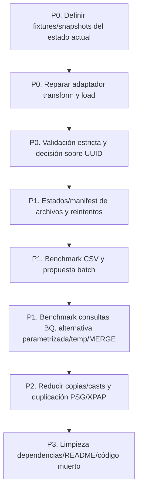

# Diagnóstico priorizado y propuesta de refactorización incremental

**Base:** commit `b7c3f2d905608b9987eaaedde6916d625ace83b1` (v4.1.1). **Estado:** propuesta, NO implementada. **Etiquetas:** `C` = defecto/ineficiencia confirmado por análisis del código; `R` = riesgo plausible que requiere prueba; `M` = mejora menor. Impacto esperado no cuantificado sin datos representativos, pruebas de carga o métricas BQ. Las estimaciones de esfuerzo son **relativas** (B/Bajo, M/Medio, A/Alto), no compromisos de tiempo.

## 1. Matriz de decisiones

| Prioridad | Problema | Evidencia | Impacto | Cambio propuesto | Riesgo | Esfuerzo |
|---|---|---|---|---|---|---|
| P0 · corrección urgente | **Load no encuentra configuración** | `3_load/main.py::BASE_DIR` ya es repo; `FLOW_CONFIG_PATHS` usa `BASE_DIR.parent / '0_declarations'` | Impide uso del load estándar | Resolver ubicación desde raíz de repo; prueba de ruta absoluta desde distintos cwd | B | B |
| P0 · corrección urgente | **Load no interpreta YAML vigente** | `load_runtime_config` exige claves de raíz; `psg.yaml`/`xpap.yaml` las guardan en `load`; `load_schema` fallback `schema.output.columns` inexistente | Impide carga; potencial esquema inadecuado con workaround | Adaptador explícito `raw['load']` y puntero `schema.load.input.columns`; validar schema y nombre de flujo | M | M |
| P0 · corrección urgente | **Transform no ejecuta pasos ni valida schema** | `2_transform/main.py::FLOW_DEFAULT_CONFIGS` apunta a declaraciones; `psg/xpap.main.run` pasa YAML raíz, `runner` busca `steps` en raíz; input/output validation reciben `{}` | Datos sin procesar presentados como transformados | Adaptador `transform` + `schema.transform.{input,output}`; requerir al menos un `step`, schema y operación reconocida | M (datos existentes) | M |
| P0 · corrección urgente | **Reprocesamiento automático de resultados** | `2_transform/{psg,xpap}/main.py::_discover_input_files` acepta prefijo sin filtrar `_transformed` ni `_loaded` | Sobrescrituras, duplicación de salidas, fallo/esquema contaminado | Restringir autodiscovery a archivos crudos elegibles, preferiblemente CSV y patrón estricto | M (entradas manuales) | B |
| P0 · corrección urgente | **Identificadores pueden perder ceros a la izquierda** | `commons.io.readers.read_dataset` y `3_load.read_source_dataset`: pandas infiere tipos al leer CSV; `.astype("string")` posterior no reconstruye ceros perdidos | Alteración de identificadores de paciente, riesgos de vinculación | Leer `id`/`pte_id` como texto desde la ingestión y exigir preservación literal; verificar formatos Excel y no inferir longitudes | M/A (contrato identificadores) | M |
| P0 · corrección urgente | **Deduplicación no encuentra UUID final** | `runner._drop_rows_with_duplicated_uuid` solo busca `UUID`; op clínica cambia a `basal_uuid`/`xpap_uuid` | Duplicados del lote atraviesan transform | Configurar `uuid_field` por flow; elegir explícitamente deduplicar antes o después de transformar | A (regla de negocio) | M |
| P0 · corrección urgente | **Errores convertidos a NA antes de validar** | `3_load.cast_dataframe(...errors='coerce')` precede a `validate_date_field` y `normalize_empty_values` | Fechas/números inválidos silenciosos; falsos negativos de validación | Comparar valores crudos vs parseo y rechazar o cuarentenar según política; conservar motivo y fila | A (regla de validación) | M |
| P1 · integridad | **Estado BQ y fichero no reconciliable** | `run`: `load_job.result()` seguido de `move_loaded_input_file` sin estado persistente; precheck remoto no es atómico con append | Reintento tras fallo de move; carrera entre cargas | Manifiesto por lote + `job_id` determinista + reconciliación; después estrategia BQ idempotente y atómica si se aprueba | M/A | A |
| P1 · integridad | **Descarte/silencio de archivos y parseo** | BASAL sin `.docx`, errores per-file atrapados, `archivos_validos` cuenta solo extensión, `_move_processed_file` silencia fallo | Registros incompletos o falsos éxitos | Estado por archivo (leído/parsing/escrito/movido/rechazado), métricas reconciliadas; política DOCX PSG | M (alcance) | M |
| P1 · integridad | **UUID desconocido permitido** | `extract_uuid_values` omite vacíos; `validate_batch_duplicates` solo exige que haya alguno válido; hash error devuelve `N/A` | Registros sin identidad confiable, carga inconsistente | Validar UUID no vacío por **cada fila**, hash erróneo = error, mantener algoritmo MD5 hasta decisión de migración | M | B |
| P1 · rendimiento | **Lectura completa por cada append CSV** | `_append_row_unified` llama `_read_existing_rows_and_header`: `rows=list(reader)` siempre | E/S y CPU cuadráticos con número de filas; pico memoria lineal | Escritura por lotes con cabecera normalizada, append simple; reescritura excepcional con temporal atómico | M (orden y esquema) | M |
| P1 · rendimiento / coste BQ | **Una consulta por 5.000 UUID** | `find_existing_uuids` hace un query job por bloque | Latencia, jobs, posible bytes escaneados y coste | Evaluar lote único parametrizado para volúmenes pequeños; staging temporal + anti-join/MERGE para grandes; medir bytes y coste | M/A (semántica duplicados) | M/A |
| P1 · calidad | **Campos de migración declarados pero ausentes del schema** | `load.migrated_field` = `basal_migrado`/`xpap_migrado`, no están en `schema.*.output.columns`; `add_migration_mark` comprueba existencia | No queda timestamp de migración en dataset | Decidir si se incorpora columna en contrato/BQ o se registra en manifiesto/auditoría separada | A (cambio de contrato) | M |
| P1 · configuración | **Rutas `../../staging` incoherentes** | `0_declarations/*.yaml extract.entrada.ruta/salida.carpeta_csv` relativas a carpeta YAML; escritura real fuerza repo/staging | CLI por defecto errónea; configuración no expresa destino real | Usar rutas relativas a repo inequívocas y validar *path resolution*; preservar CLI explícita | M | B |
| P2 · rendimiento | **Casting redundante load; relecturas de YAML** | `cast_dataframe` y `normalize_empty_values` repiten conversiones; `{psg,xpap}.execute/run` leen YAML por archivo | CPU, copias, memoria, I/O | Normalización única instrumentada; cargar cfg una vez por corrida y pasar objeto | B/M | B/M |
| P2 · rendimiento | **Copias y limpiezas repetidas en transform** | `transforms::_normalize_dtypes` hace `copy`, múltiples `_clean_float_series` para las mismas columnas, selección final `.copy()` | CPU/RAM; GC | Reutilizar Series numéricas, minimizar copias seguras con tests de equivalencia; no suprimir conversiones a ciegas | M | M |
| P2 · rendimiento | **Enumeración completa de árbol** | `procesar_directorio`: `archivos = list(ruta.glob(glob_patron))` | Pico RAM O(n archivos), no escalar a millones | Iterador `os.scandir`/glob gradual cuando no se necesite `tqdm(total)`, separar conteo | B | B |
| P2 · robustez | **Escritura no atómica** | `write_dataset` escribe directo a destino; `_rewrite_with_header` trunca; mueve original sin journaling | Archivos parciales tras crash/interrupción | Temporal en mismo FS + flush/fsync cuando proceda + `os.replace`; manifest de estados | M | M |
| P2 · diseño | **Duplicación PSG/XPAP** | ejecutores `main.py` casi idénticos; transforms repiten limpieza, antropometría y categorías | Doble mantenimiento y deriva de reglas | Parametrizar core común conservando adaptadores por flow y regex clínicos independientes | M/A (regresión semántica) | M |
| P2 · calidad | **Relleno silencioso de output** | `for column in FINAL_COLS: df[column]=pd.NA` | Hace pasar campos ausentes como presentes; falsos negativos de schema | Separar opcionales/obligatorias, capturar porcentaje nulo/códigos motivo antes de rellenar | A (contrato) | M |
| P2 · mantenibilidad | **Logs y errores sin modelo uniforme** | extract captura por archivo, transform excepciona; load traceback; varias rutas/handlers | Difícil monitoreo y reanudación | Run-ID, counters, salida de errores agregados sin PHI, niveles consistentes | B | M |
| P2 · seguridad/operación | **Confirmaciones, TRUNCATE y credenciales** | load permite `WRITE_TRUNCATE` desde YAML y `1`, muta `GOOGLE_APPLICATION_CREDENTIALS` | Borrado accidental y dependencia de secreto local | Refuerzo confirmación TRUNCATE; inyección de credenciales/ADC; cuentas mínimas | M | B/M |
| P3 · menor | **Código muerto, README divergente, dependencias amplias** | `maybe_unify` vacío; `unificar_resultados` inactivo/auxiliares inexistentes; README alude configs ausentes; requisitos sin lock | Confusión, instalación más pesada, onboarding | Etiquetar legado, corregir documentación; reducir deps **solo tras pruebas de import** | B | B/M |

## 2. Recomendaciones detalladas: correcciones urgentes

### R01. Adaptador versionado de configuración de 2_transform [P0-C]

- **Código:** `2_transform/main.py`, `{psg,xpap}/main.py::_load_pipeline_config/_apply_declared_schemas`, `commons/engine/runner.py`, YAML declarativos.
- **Justificación:** contrato `transform.steps` nunca llega a `run_pipeline.steps`; validadores reciben mapas vacíos. No se trata de optimización sino de ejecución incompleta.
- **Cambio mínimo:** una función validada `resolve_transform_config(shared_yaml, flow)` que construya `{input,steps,output,schema:{input,output}}` con `schema.transform.input.columns` y `.output.columns`; verificar `metadata.domain == flow`, pasos no vacíos, operación registrada. Usarla en `execute` una sola vez y pasar el resultado a `run`.
- **Beneficio:** vuelve ejecutable el contrato **sin cambiar cálculos ni columnas**. Eliminación de reads duplicados como ventaja secundaria.
- **Regresión:** los Excel existentes que contienen columnas raw dejarán de considerarse transformados; deben **cuarentenarse/revalidarse**, no cargarse ni retransformarse sin política.
- **Tests:** YAML PSG y XPAP, mock registry/spy del step, columnas antes/después, `--dry-run`, falta de paso y flujo cruzado, test de equivalencia con fixture clínico aprobado.
- **Medición:** `steps_executed` (esperado 1), columnas = schema output, conteo input/output con explicación de dedup, `df.compare` golden dataset.

### R02. Adaptador y rutas de load [P0-C]

- **Código:** `3_load/main.py::BASE_DIR/FLOW_CONFIG_PATHS/load_runtime_config/load_schema` y `0_declarations/*.yaml`.
- **Cambio mínimo:** `REPO_ROOT = Path(__file__).resolve().parents[1]`; ruta `REPO_ROOT / '0_declarations'`; `raw['load']` validada; `schema_yaml_path = YAML original` y `schema_path_in_yaml = 'schema.load.input.columns'`. Resolver claves de ruta de credenciales desde raíz repo y usar `Path.resolve`. Cotejar schema `schema.transform.output.columns == schema.load.input.columns` antes de BQ.
- **Beneficio:** activa integración y previene esquemas divergentes sin tocar tablas.
- **Regresión:** errores de path/credenciales en instalaciones antiguas; migrar de forma explícita y probar cwd independientes. **No ejecutar BQ real** en el primer PR.
- **Tests/medición:** pruebas unitarias de ruta y YAML, `client` simulado; validación de `SchemaField` esperados y de inexistencia de consultas si falla config.

### R03. Semántica de UUID y deduplicación [P0-C; D]

- **Código:** `2_transform/commons/engine/runner.py`, `<flow>/core/transforms.py`, `3_load/main.py`, `1_extract/commons/archivo_utils.py`.
- **Cambio:** especificar clave por flujo; rechazar nulos y `N/A`; decidir política exacta para duplicados dentro del lote (`rechazar todo`, `keep=first` o `quarantine`), y si dos informes con idénticos bytes son un mismo estudio. **Por defecto no modificar la semántica clínica hasta decisión formal**.
- **Riesgos:** deduplicar puede reducir recuentos que antes se cargaban; cambiar MD5 a SHA-256 cambia claves históricas y compatibilidad BQ. Proponer SHA-256 solo como nueva columna de *content hash*, no sustituir `*_uuid` unilateralmente.
- **Tests/medición:** N UUID duplicados con orden invertido, vacíos, whitespace, diferentes documentos mismo contenido y reejecución; métricas `duplicate_count`, `rejected_count`, integridad de entidad.

### R04. Validaciones fail-closed y trazabilidad [P0-C; D]

- **Código:** `3_load.cast_dataframe/validate_date_field/normalize_empty_values/read_source_dataset`, `2_transform/commons/schema/validators.py`, `.../transforms.py`.
- **Cambio:** preservar campos identificadores como cadenas **desde `read_csv`** (y revisar tipado de las celdas Excel); validar **sobre valor original antes de `errors='coerce'`**, guardar índice, campo, valor original y causa (sin PHI en logs compartidos). Validar cada UUID, columnas adicionales y umbrales de nulidad configurables; definir cuáles campos son obligatorios vs opcionales y valores centinela.
- **Riesgos:** endurecer rechazo cambia el conjunto cargado; **requiere decisión** y comparación con registros históricos. Fijar `dayfirst` y formatos explícitos según fuente y datos reales; conservar tratamiento actual bajo pruebas hasta aprobación.
- **Tests/medición:** valores inválidos, fechas ambiguas, booleanos, identificadores como texto, valores vacíos; *coercion_loss_rate* por campo = entradas no nulas devenidas NA.

## 3. Alto retorno en recursos (después de P0)

### R05. Cambiar algoritmo de acumulación CSV sin cambiar schema [P1-C]

- **Evidencia:** en `_append_row_unified`, la primera llamada interna carga **todas** las filas previas incluso si solamente añade una nueva. Para N filas, lee aproximadamente `0+1+2+...+(N-1)` filas, es decir **O(N²)** de volumen acumulado leído; el número real de bytes varía con tamaño de las filas.
- **Diseño incremental:** extraer el lote de `dict` en memoria acotada (p. ej., 500–5.000, parámetro por medir); calcular unión de cabeceras para el lote; escribir **una sola vez** a CSV nuevo, o append con cabecera estable y eventual reescritura atómica cuando cambie el conjunto. Si es imprescindible detectar columnas tardías, mantener un esquema predefinido por flujo mejor que acumular la unión sobre marcha.
- **Complejidad prevista:** O(N) en lectura/escritura total para cabecera fija; memoria O(batch). **No se asigna porcentaje de ahorro** sin benchmarking.
- **Riesgo:** orden de columnas, comillas, saltos, duplicados y crash justo antes de archivar originales. Mantener pruebas golden a nivel byte/tabla y crash-recovery.
- **Benchmark:** N={100,1.000,10.000,50.000}, tipos/longitudes de filas representativos y porcentaje de aparición de nuevas columnas; medir `perf_counter`, RSS máximo, bytes leídos/escritos (psutil/proc o strace), contenido final y filas/UUID. Calcular ratio tiempo nuevo/antiguo. Mantener dataset sintético sin PHI.

### R06. BigQuery: disminuir jobs y garantizar idempotencia [P1-R]

- **Evidencia:** `find_existing_uuids` ejecuta `ceil(N/5000)` consultas parametrizadas por batch. **Sí existe trabajo repetido de cliente/query jobs**. **No está medido** cuánto BQ escanea por bloque: depende de particionado, clustering, tamaño de destino y optimizador.
- **Opciones comparables:** (A) un solo query parametrizado para N pequeño siempre que respete límites de parámetros/payload; (B) cargar conjunto de UUID a tabla temporal y ejecutar un solo join/anti-join; (C) staging temporal de datos + `MERGE` transaccional por `uuid`, con política de rechazo/conteo explícita. **MERGE puede ser más caro en bytes y slots**, no escogerlo solo por reducir número de jobs.
- **Corrección clave:** precheck + `WRITE_APPEND` tiene ventana TOCTOU ante cargas concurrentes. `MERGE` es una posible solución si las garantías y la tabla lo permiten; alternativamente bloqueo de flujo con batch registry; documentar las garantías reales.
- **Métricas:** BQ `total_bytes_processed`, `total_slot_ms`, wall-clock, número de query/load jobs, bytes transferidos, coste estimado por tarifa real y total de UUID nuevos/existentes. Probar con destinos de cardinalidad creciente y misma tasa de duplicados. Seleccionar alternativa solo tras ensayo.
- **Regresión:** política todo-o-nada actual de `find_existing_uuids` frente a insertar solo nuevos con MERGE; requiere decisión del negocio. `WRITE_TRUNCATE` queda fuera de este cambio hasta revisar uso.

### R07. Eliminar coerción/relectura duplicada [P2-C]

- **Código:** `3_load.cast_dataframe` + `normalize_empty_values`; `_load_pipeline_config` doble lectura en `execute/run`; `_clean_float_series` repetida en cada op clínica.
- **Cambio:** una función única de normalización con *audit masks* y una lectura de config por ejecución; cachear Series tipadas por columna en ámbito local. No añadir caché global ni framework.
- **Beneficio:** menos transformaciones `O(filas × columnas)` y menos temporales; valor depende de tamaño de lotes.
- **Riesgos/tests:** correspondencia exacta entre strings vacías/NA/NaT/nullable dtypes; snapshot de `df.dtypes`, NULL masks, categorizaciones y valores; rendimiento CPU (cProfile) y peak RSS (memray/tracemalloc sabiendo sus límites para memoria nativa pandas).

### R08. Excel y streaming selectivo [P2-R]

- **Evidencia:** ambas fases `read_dataset/read_source_dataset` leen archivo completo; `write_dataset` materializa Excel entero, y el loader usa `load_table_from_dataframe`. Si los lotes son pequeños no es necesariamente un problema.
- **Medir primero:** tamaño máximo por archivo, filas/columnas, RSS real y tiempo serializando Excel. **Solo** si justificado: conservar XLSX como revisión humana pero exportar adicionalmente formato columnar o CSV tipado de igual contrato para la carga; CSV con `chunksize` para etapas compatibles; XLSX con lectura stream de openpyxl/read_only si se necesitase. `load_table_from_dataframe` seguirá materializando chunks en RAM salvo rediseño por lotes.
- **Riesgo:** lectura chunk-by-chunk no debe cambiar dedup global ni tipos de fechas/decimales y mezcla de categorías; diseño debe mantener un índice de UUID persistente o estado de lote. Excel no soporta >1.048.576 filas por hoja.

## 4. Propuesta estructural mínima y orden recomendado

**Arquitectura objetivo:** conservar `0_declarations`, `1_extract`, `2_transform`, `3_load` y `staging` por ahora. Añadir adaptadores de contrato por fase y **un objeto inmutable de configuración validada por ejecución**; un manifiesto operativo local mínimo que registre `run_id`, `flow`, hash del fichero de entrada, ruta, esquema/versión, recuentos y estados `DISCOVERED/EXTRACTED/TRANSFORMED/LOADING/LOADED/ARCHIVED/FAILED`. Añadir `bq_job_id` y resultado. Reutilizar base del runner transform para ambos flujos; solo las funciones clínicas y mapeos difieren. **No** proponer Airflow, Spark, Dataproc, Pub/Sub ni nuevas bases sin demostrar necesidad operativa.

### Hoja de ruta en PR pequeños

| Orden | PR propuesto | Alcance admitido | Aceptación / puerta de salida |
|---|---|---|---|
| 0 | Baseline y fixtures | Solo tests de caja negra y snapshots de YAML | Documenta comportamiento previo y escenarios rotos, cero escrituras BQ |
| 1 | Adaptador config transform | No cambia reglas `psg_basal_transform`/`xpap_transform` | Se invoca exactamente un paso por flujo; salida coincide contrato; `--dry-run` no escribe |
| 2 | Adaptador config load | Solo rutas/secciones/schema; cliente BQ mockeado | Construye config y schema correctos, no carga real |
| 3 | Control de input y UUID | Descubrimiento raw estricto, invalid UUID rechazo; dedup según decisión | Ejecutar dos veces no genera nuevos `*_transformed_transformed`; conteo trazable |
| 4 | Validación fecha/numérica | Fallos explícitos o cuarentena según política acordada | No aparecen NA nuevos silenciosos sin contador y motivo |
| 5 | Manifiesto/recuperación | Estados locales y reconciliación de jobs | Reintentos de fallo antes/durante/después de BQ sin duplicados |
| 6 | Rendimiento CSV | Batch + escritura atómica | Igual schema/orden/contenido en goldens; perfil mejora bajo carga |
| 7 | BQ por lotes/atomicidad | Piloto comparativo y semántica acordada | Menor coste/latencia medidos sin alterar conteo ni protección de duplicados |
| 8 | Simplificación del core | Consolidar código duplicado y limpiar dependencias | 100% paridad de fixtures, cobertura de casos clínicos |

## 5. Decisiones necesarias ANTES de implementar

1. **Duplicados:** en extracción, transform y load, ¿se conserva el primer documento (`keep=first`), se rechaza el lote o se separan duplicados para revisión? ¿Mismo contenido hash implica mismo estudio? **Cambio de negocio**.
2. **Campos clínicos obligatorios y nulos:** ¿cuáles admiten `N/A`, `NaT` o campos faltantes? ¿Se permite imputar 0 a edad parcial o categorizar IAH con edad desconocida? **Cambio de negocio**.
3. **Ambigüedad de fechas:** origen `DD/MM/YYYY` vs `YYYY-MM-DD`, fechas de 2 dígitos y zonas; cómo resolver discrepancia con documentación clínica. **Cambio de contrato semántico**.
4. **Identidad y trazabilidad:** la `uuid` actual es MD5 del archivo; preservar IDs BQ o añadir identificador por estudio e ID de fuente por separado. **Cambio potencial de clave**.
5. **Formato de intercambio:** Excel es una revisión/garantía operativa deliberada o solo formato histórico. Abandonarlo puede ser cambio de contrato operativo.
6. **Semántica de BQ:** todo-o-nada si hay UUID existente frente a insertar solo nuevos; uso real de `WRITE_TRUNCATE`, tolerancia a concurrentes y particionado/clustering. **Cambio de política de carga**.
7. **Procesamiento PSG DOCX:** hoy extensión permitida pero no hay parser; decidir soportarla o rechazar con razón visible, con fixtures que representen el formato.
8. **`*_migrado`:** columna nueva en tabla analítica o metadato fuera de schema, dejando inalterado contrato por ahora.

## 6. Evidencia y límites de medición

- **Problemas comprobados:** desajustes YAML/rutas, dedup por nombre, lectura cuadrática CSV, autodiscovery de transformados, cast duplicado, ausencia de migrado en schema, relleno `pd.NA`, logs/errores por archivo.
- **Riesgos condicionados:** query scans/coste BQ, presión RAM bajo volumen alto, colisiones por ejecución en mismo minuto, carreras de carga, fecha clínica corrupta en una población real, E/S concurrente. Requieren muestras y/o mocks/ensayos.
- **Mejoras menores:** comentarios, nombres, imports, funciones legado, `1_extract/src/basal/config_basal.yaml` con referencias históricas a Sheets y librerías superfluas; no atribuir impacto hasta un import profiler / instalación mínima.
- **No probado:** ejecutar archivos reales, cuantificar latencia/CPU/RSS/bytes, coste BQ, interoperabilidad con schema remoto, cobertura pytest efectiva. La conexión Github permitió analizar fuentes pero **no clonar ni ejecutar** el proyecto dentro de un ambiente con sus dependencias y credenciales. Consultar [testing-gaps.md](testing-gaps.md) para programa de verificación.

## 7. Fuentes del commit

- [`3_load/main.py`](https://github.com/moafar/obsino-clisueno/blob/b7c3f2d905608b9987eaaedde6916d625ace83b1/3_load/main.py)
- [`1_extract/commons/archivo_utils.py`](https://github.com/moafar/obsino-clisueno/blob/b7c3f2d905608b9987eaaedde6916d625ace83b1/1_extract/commons/archivo_utils.py)
- [`2_transform/commons/engine/runner.py`](https://github.com/moafar/obsino-clisueno/blob/b7c3f2d905608b9987eaaedde6916d625ace83b1/2_transform/commons/engine/runner.py)
- [`2_transform/psg/main.py`](https://github.com/moafar/obsino-clisueno/blob/b7c3f2d905608b9987eaaedde6916d625ace83b1/2_transform/psg/main.py)
- [`2_transform/xpap/main.py`](https://github.com/moafar/obsino-clisueno/blob/b7c3f2d905608b9987eaaedde6916d625ace83b1/2_transform/xpap/main.py)
- [`0_declarations/psg.yaml`](https://github.com/moafar/obsino-clisueno/blob/b7c3f2d905608b9987eaaedde6916d625ace83b1/0_declarations/psg.yaml) / [`xpap.yaml`](https://github.com/moafar/obsino-clisueno/blob/b7c3f2d905608b9987eaaedde6916d625ace83b1/0_declarations/xpap.yaml)
